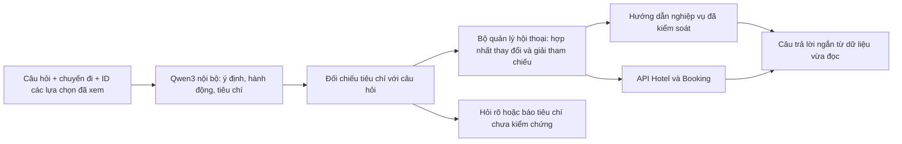

# Phạm vi và kiểm chứng trợ lý EnziuRooms v5

## Luồng xử lý



Mô hình không sinh giá, phòng trống, thông tin đơn hay nhận xét khách hàng. Mô hình không được huấn luyện lại trên dữ liệu khách hàng. Đây là mô hình nguồn mở chạy trên máy chủ của hệ thống, không cần tài khoản/API key Gemini.

## Những nhóm câu hỏi được xử lý

| Nhóm | Cách xử lý |
| --- | --- |
| Tìm nơi ở, tên địa phương khác nhau, câu không dấu | Phân tích ý định và chuẩn hóa địa điểm; đối chiếu danh mục thật |
| Phòng cho gia đình, số người lớn/trẻ em | Giữ dữ liệu chuyến đi nếu người dùng chưa đổi; kiểm tra sức chứa và phòng trống thật |
| Giá thấp nhất, diện tích lớn nhất | Xếp hạng bằng trường giá/diện tích đã công bố; thiếu trường thì không khẳng định nhất |
| Nhiều điều kiện cùng lúc | Phân biệt ưu tiên xếp hạng và điều kiện bắt buộc, như rẻ + ăn sáng + hoàn tiền |
| Thêm/bỏ tiện nghi, bỏ giới hạn tiền/hạng sao | Chỉ cập nhật các điều kiện được nhắc đến; giữ điều kiện còn lại |
| Ngân sách cả chuyến hoặc mỗi đêm, tiền viết bằng chữ | Chuẩn hóa số tiền; chia theo số đêm nếu là cả chuyến; hỏi ngày nếu thiếu |
| Khách sạn khác, phòng khác, “lựa chọn khác” | Dựa vào đối tượng đang hỏi, giữ tiêu chí, loại ID thực sự đã hiển thị và báo khi hết |
| “Lựa chọn thứ hai”, so sánh các lựa chọn trước | Dùng thứ tự thẻ hiển thị, xác minh lại ID và khách sạn sở hữu phòng |
| Đổi ngày/số khách rồi kiểm tra lại | Dùng ngày/số khách mới, không bắt người dùng nhắc lại toàn bộ nhu cầu |
| Đánh giá, thông tin liên hệ/địa chỉ/tiện nghi | Đọc dữ liệu thật; phân biệt xem nhận xét với hướng dẫn viết nhận xét |
| Thanh toán, QR, cọc, hủy, đổi phòng, nhận/trả | Hướng dẫn nghiệp vụ đã kiểm soát; thông tin đơn chỉ lấy từ tài khoản đăng nhập |
| Câu mơ hồ hoặc điều kiện chưa hỗ trợ | Hỏi rõ/báo giới hạn thay vì tự thêm tiêu chí hoặc khẳng định không có dữ liệu |

Tìm gần địa điểm dùng tọa độ bản đồ và khoảng cách đường chim bay, với bán kính mặc định 5 km hoặc bán kính khách nêu (0,1–100 km). Chỉ đường là tác vụ riêng, cung cấp địa chỉ và liên kết bản đồ giữ điểm xuất phát/khách sạn đang xét. Chatbot chưa tự tính khoảng cách theo đường đi/thời gian di chuyển; các yêu cầu này xem trên bản đồ. Hướng nhìn hay bộ lọc loại giường chưa được triển khai đầy đủ; trợ lý báo rõ thay vì âm thầm bỏ điều kiện. Việc không có tiện nghi trong danh sách không tự chứng minh khách sạn không có tiện nghi đó.

## Bộ kiểm thử chủ động

- Java: kiểm thử dữ liệu và hội thoại, gồm nhiều lượt tìm kiếm, hết kết quả, đổi địa điểm, cập nhật chuyến đi, xóa/thêm tiêu chí, ngân sách, số khách và tham chiếu phòng.
- Frontend: bộ nhớ ID khách sạn/phòng không phụ thuộc lịch sử văn bản rút gọn; giữ thứ tự thẻ, điều kiện phòng, lịch và số khách.
- Python: kiểm tra tiêu chí mô hình tự thêm bị loại, phạm vi thêm/bỏ điều kiện độc lập và chuyển đổi số tiền; ma trận nhiều cách diễn đạt đổi lịch.
- Hai bộ câu hỏi cố định có tổng **100 câu**. Báo cáo chứa từng câu, kết quả và lỗi, không chỉ tổng điểm:
  - `docs/assistant-semantic-evaluation.json`: 75 câu chủ đề, hành động và câu mơ hồ.
  - `docs/assistant-semantic-acceptance.json`: 25 câu tiêu chí kết hợp, phủ định, câu hỏi tiếp nối và điều kiện chưa hỗ trợ.
- CI chạy lại hậu xử lý hiện tại trên quyết định mô hình đã ghi nhận, cùng các kiểm thử nghiệp vụ. Replay không đo lại khả năng suy luận của mô hình. Đổi prompt, revision mô hình hoặc nội dung câu hỏi bắt buộc phải tạo bản ghi từ suy luận mới; script từ chối dùng bản ghi cũ.
- Kiểm thử mới qua mô hình thật dùng `evaluate.py` không có `--replay`. Script trả exit code khác 0 nếu còn câu chưa đạt.
- `scripts/verify-local-assistant.ps1` gọi backend tạm bằng JWT thử nghiệm riêng và các API danh mục công khai; không dùng token khách hàng. Script kiểm tra câu trong ảnh, sức chứa, phòng trống, khách sạn khác không trùng, phòng khác và tham chiếu thứ tự.

100 câu đạt kiểm tra không chứng minh hiểu đúng mọi cách diễn đạt. Cần mở rộng bộ đánh giá theo chức năng sản phẩm và đo lại khi thay mô hình/prompt; không coi điểm cosine hoặc JSON đúng schema là xác suất hiểu đúng.

Kết quả bàn giao ngày 28/10/2026: **85 kiểm thử Java, 6 kiểm thử frontend, 7 nhóm kiểm thử đối chiếu tiêu chí** đã qua; replay 75 + 25 câu đạt đủ. Kiểm chứng mới qua API thật đã xác nhận 9 khách sạn không trùng, phòng khác không lặp, đúng phòng thứ hai, đổi ngày, giữ WiFi/bỏ hồ bơi và ngân sách 1,5 triệu cho 2 đêm thành 750.000 ₫/đêm. Bước chuyển sang chọn phòng cũng giữ đúng giới hạn đó.

Bản chạy thực tế đã được đối chiếu cùng image dùng trong kiểm thử. Xem [báo cáo runtime](assistant-runtime-verification.json) và [báo cáo luồng dữ liệu thật](assistant-local-verification.json). Đây là kiểm chứng tại thời điểm chạy, không phải cam kết giá/phòng trống cố định hay độ chính xác tuyệt đối của mọi câu hỏi.

## Chạy và chi phí tài nguyên

Tải mô hình một lần:

```powershell
python services/dialogue-model/download_model.py
docker compose up -d --build dialogue-model semantic-service ai-service
```

Tệp GGUF khoảng 2,5 GB, được ghim revision/SHA-256 và bỏ qua trong Git. llama.cpp được ghim digest. Container chỉ gắn mạng Docker `semantic-internal` có `internal: true`, không publish cổng và không gửi câu hỏi ra API mô hình bên ngoài. Model nạp từ tệp chỉ đọc và kiểm tra checksum mỗi lần khởi động. Nhật ký nội dung mô hình bị tắt.

Cấu hình CPU hiện tại giới hạn mô hình ở 6 CPU, 3500 MB RAM và một lượt suy luận đồng thời. Sau khi làm nóng, đo trong lượt thử có truy vấn mất khoảng 5–15 giây; câu nhiều tiêu chí có thể lâu hơn. Đây chưa phải đánh giá tải nhiều người dùng. Khi mô hình/dịch vụ semantic lỗi, backend trả về chế độ cơ bản với metadata đúng, không âm thầm gọi nhà cung cấp khác.

`engine.semanticModel` của bản dùng Qwen là `Qwen3-4B-Instruct-2507-Q4_K_M`; `externalModelUsed=false`. Cần kiểm tra cùng image đang chạy và mạng Docker, không chỉ nhìn nhãn trên giao diện.
